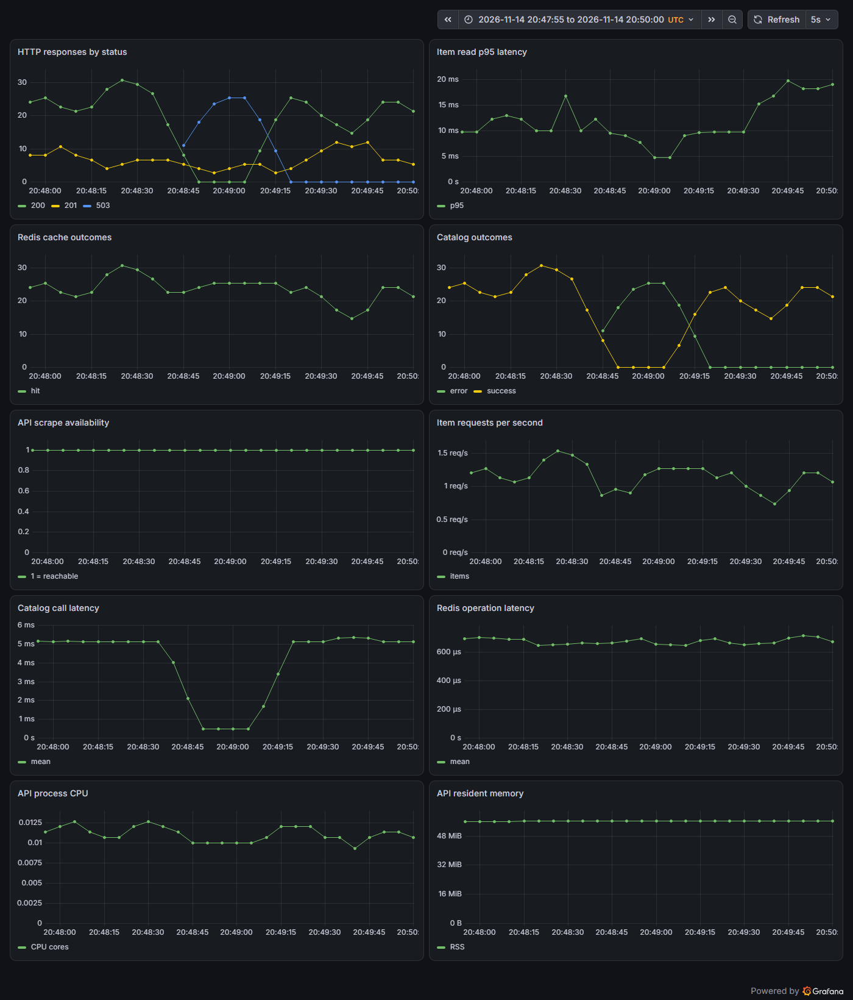

# Verify Ops

An agentic AI Ops framework for reliable cloud incident diagnosis and recovery.

## What we are solving

An API process can be running while requests fail because Redis is unavailable. Verify Ops will detect that failure, collect evidence, suggest a permitted action, and verify recovery with a real application request. A completed restart and a recovered application are recorded separately.

## Project structure

| Path | What belongs there |
| --- | --- |
| `main.py` | Current FastAPI entry point with process health and Redis readiness routes. |
| `requirements.txt` | Python dependencies for the API image. |
| `Dockerfile` and `compose.yaml` | Build the API image and run the local API and Redis services on a shared network. |
| `observability/` | Application metrics, structured logs, Prometheus scrape configuration and Grafana dashboard provisioning. |
| `chaos/` | Locust traffic and controlled fault scenarios with cleanup and ground truth. |
| `analysis/` | Healthy and incident windows, anomaly detection and root-cause ranking. |
| `agent/` | LangGraph evidence collection and diagnosis with Bedrock and local Ollama adapters. |
| `remediation/` | Action policy, approval, dry-run and execution adapters. |
| `verification/` | User-facing recovery probes, evidence thresholds and verdicts. |
| `dashboard/` | Operator UI for evidence, approvals and recovery. Grafana remains the telemetry view. |
| `evaluation/` | Repeatable incident fixtures, expected outcomes and comparisons. |
| `cloud/` | EC2 workload configuration, CloudWatch collection, IAM and Systems Manager setup. |

Runtime logs and generated evaluation reports are written locally by the demo and experiment commands.

## How the pieces connect

```text
Locust → FastAPI item request → Redis
FastAPI metrics → Prometheus scrape → Grafana and Python analysis
Structured logs + anomaly evidence → LangGraph → Bedrock or Ollama
Diagnosis → operator approval → permitted action
Verification probes → FastAPI item request → recovery verdict
```

Inside Compose, the API reaches Redis through `REDIS_URL=redis://redis:6379/0`. Here `redis` is the service name, which Compose resolves on its network. On Windows you reach the API at `http://127.0.0.1:8002`. To use another host port, set `$env:VERIFY_OPS_PORT` in the PowerShell session that runs Compose and the experiment. Prometheus and Locust use `api:8000` inside Compose. Grafana uses `http://prometheus:9090` as its data source.

## Live Grafana demo



The screenshot shows our own catalog-failure experiment under Locust traffic. Item reads returned HTTP 503 while Prometheus continued to scrape the API. Catalog errors rose during that interval. After the fault was cleared, HTTP 200 responses returned and catalog errors fell. The dashboard also shows request throughput, item-read p95 latency, cache outcomes, catalog and Redis latency, process CPU and resident memory.

```powershell
docker compose --profile traffic up -d --build
python -B -m chaos.run_experiments catalog-failure
```

Open Grafana at <http://localhost:3000> and search for **Verify Ops Monitoring**. Set the time range to the last five minutes. Prometheus target status is at <http://localhost:9090/targets>, and alert rules are at <http://localhost:9090/alerts>. Open <http://localhost:8002/> for live findings and saved experiment results. Finish with `docker compose --profile traffic stop locust`.

## Reference workflow and Verify Ops extensions

| Stage | Verify Ops implementation |
| --- | --- |
| Run and instrument a workload | FastAPI, Redis, Compose, Prometheus metrics, application logs, Grafana and Locust |
| Inject controlled faults | Seven scenarios covering Redis and catalog latency and failure, API outage, CPU spike and memory growth |
| Detect and rank | Live dependency counter polling, Prometheus alerts, and a separate experiment path using rolling MAD, CUSUM and dependency-aware ranking |
| Diagnose | LangGraph collects metrics, logs and available incident or deployment history, validates model evidence and can expand its evidence once. Ollama and Bedrock adapters are available. |
| Remediate | The runbook can recommend a restart from the diagnosis. Operators choose the action and approve it. Supported actions are a local API restart, a scoped cache flush, and an EC2 API restart through Systems Manager. |
| Evaluate | Replay saved statistical rankings, compare model-assisted diagnosis, and test verification against five recovery fixtures |
| Verify recovery | Write and read an item, compare its payload, check Redis readiness and wait for a fresh Prometheus scrape. Record the verdict separately from command completion. |
| Deploy on AWS | The test workload ran on EC2, emitted application logs to CloudWatch and passed the Systems Manager restart command. |

The reference uses a LangGraph approval interrupt; Verify Ops uses an expiring, single-use CLI approval file bound to the incident, action and container. Verify Ops currently supports restart and cache flush. Scale-out and deployment rollback appear among the reference's proposed actions, and its executor implements restart and flush. The Bedrock adapter in Verify Ops still needs a live invocation check. See [methodology and metrics](docs/methodology.md) for evaluation boundaries and reproduction commands.

## Build checklist

### Run a statistical fault experiment

From this folder, run `docker compose --profile traffic up -d --build` to start Verify Ops and Locust. Then run `python -B -m chaos.run_experiments catalog-failure`. The runner records a 40-second baseline, applies the fault for about 30 seconds, clears it, and writes an evaluation JSON file under `evaluation/`. The report records the injected fault, the earliest signal, and ranked candidates from Prometheus measurements.

The scenario names are `redis-latency`, `redis-outage`, `catalog-latency`, `catalog-failure`, `app-outage`, `cpu-spike`, and `memory-growth`. Run one at a time. Clear any manually enabled faults before starting. Stop the traffic generator with `docker compose --profile traffic stop locust`.

Use `python -B -m chaos.run_experiments all` to run the seven scenarios sequentially and report how many top-ranked causes match. The full suite takes about 11 minutes.

Prometheus evaluates the configured alert rules as metrics arrive. The experiment report evaluates the captured time series with rolling MAD, CUSUM for memory, and dependency-aware ranking. The live `/incidents` endpoint currently reports changes in dependency error counters.

### Diagnose and verify a saved experiment

Run `python -m pip install langgraph` on the machine that runs the operator commands. For Bedrock or Systems Manager, also install `boto3`. Run these commands from the project folder after completing a catalog-failure experiment. The first line selects the most recent catalog-failure report.

```powershell
$report = Get-ChildItem evaluation/catalog-failure-*.json |
    Where-Object Name -NotLike '*.bedrock-request.json' |
    Sort-Object LastWriteTime -Descending |
    Select-Object -First 1 -ExpandProperty FullName
python -B -m remediation.runbook $report --action restart
python -B -m evaluation.summarize
python -B -m evaluation.replay_recovery
```

Open [saved evaluations](http://127.0.0.1:8002/evaluations) to see the expected, earliest, and top-ranked signals and any recorded actions. The live detector findings are available at [incidents](http://127.0.0.1:8002/incidents).

The runbook gathers the ranked metrics and timestamped log evidence. It defaults to statistical diagnosis. For Ollama, set `VERIFY_OPS_LLM=ollama` and `OLLAMA_MODEL` to an installed model. For Bedrock, set `VERIFY_OPS_LLM=bedrock`, `BEDROCK_MODEL_ID`, and the AWS region and credentials through the AWS SDK configuration. Model failures fall back to the statistical result.

The runbook defaults to dry-run and prints an approval file. Pass `--reject` to record rejection or `--approve --plan PATH` to execute the same action against the same container within ten minutes. The file can be used once. Restart clears the API's in-memory backing store. Cache flush removes Redis keys with the `item:` prefix. The runbook writes diagnosis, action outcome, and the item write/read verification result to a sibling `-recovery.jsonl` file. Replay compares five cases against an error-rate-only baseline.

Open the [operator page](http://127.0.0.1:8002/) to review live findings and saved results. Local approval runs through the CLI. For deployment history, write JSONL records with `timestamp` (ISO 8601), `service`, and `revision` to `logs/deployments.jsonl`. Diagnosis also reads matching earlier runbook records and expands the metric evidence once if the model asks for more evidence.

### Exercise the AWS path

On a test EC2 instance managed by Systems Manager, place the project at `/opt/verify-ops` and start Compose with the traffic profile. Configure the CloudWatch agent with `cloud/cloudwatch-agent.json` and grant the instance role access to publish logs. Run `python -B -m cloud.preflight INSTANCE_ID --profile PROFILE --region REGION` to check authentication, managed instance status and access to the CloudWatch log stream. Use SSM tunnels to forward ports 8002 and 9090 to the operator machine for the API and Prometheus. Run the catalog experiment through those tunnels to save a report.

Run `python -B -m cloud.fetch_evidence REPORT INSTANCE_ID` after the logs arrive. Set `VERIFY_OPS_EVIDENCE_LOG` to the exported file and run the diagnosis with Bedrock. The operator credentials need CloudWatch Logs read access, access to the chosen Bedrock model, and scoped Systems Manager permissions on the test instance. Run `python -B -m cloud.restart INSTANCE_ID` to preview the target. With operator approval, pass `--approve` to request the restart, observe its command status, and run the recovery probes through the same tunnels.

- [x] **1. Local stack.** Verified health and Redis readiness during startup, outage, and restoration.
- [x] **2. Demo workload.** Verified item creation and reads, cache refill, Redis fallback, catalog failure, and conditional reads.
- [x] **3. Monitoring.** Verified Prometheus scraping and alert rules, Grafana provisioning, and structured application logs.
- [x] **4. Fault experiments and ranking.** Ran all seven fault types with Locust and ranked the expected cause first in each experiment. Live incident polling still uses dependency counters.
- [ ] **5. Diagnosis and remediation.** Verified Ollama, fallback, evidence expansion, local restart and scoped cache flush. Diagnosis supports deployment and incident history. Bedrock still needs a live check.
- [x] **6. Verified recovery and cloud demo.** Verified local recovery, replay, the operator page, the EC2 catalog experiment, CloudWatch log delivery, and a successful Systems Manager restart with recovery checks. Approval is through the CLI for the local runbook. Live Bedrock inference remains unverified.

## What you set up manually

**Now:** Start Docker Desktop. Use PowerShell in this folder and open the API in your browser or use `curl.exe -i http://127.0.0.1:8002/ready` to see the HTTP status. Redis runs as a Compose service.

**During observability:** We will write the Prometheus target and Grafana data source in configuration. Compose starts the services. You open Prometheus to verify the target and Grafana to inspect the dashboard. Redis and Prometheus connections are established by the app and configuration.

**During AI and AWS integration:** Select a model and set up access in the AWS account, including the workload region, IAM permissions and Systems Manager access to the test instance. For Ollama, install it and pull the chosen model before using the local adapter. Keep credentials outside the project files.

For each implementation step, record the files changed, the expected output, the exact command or test, and the observed result before ticking the checklist.
